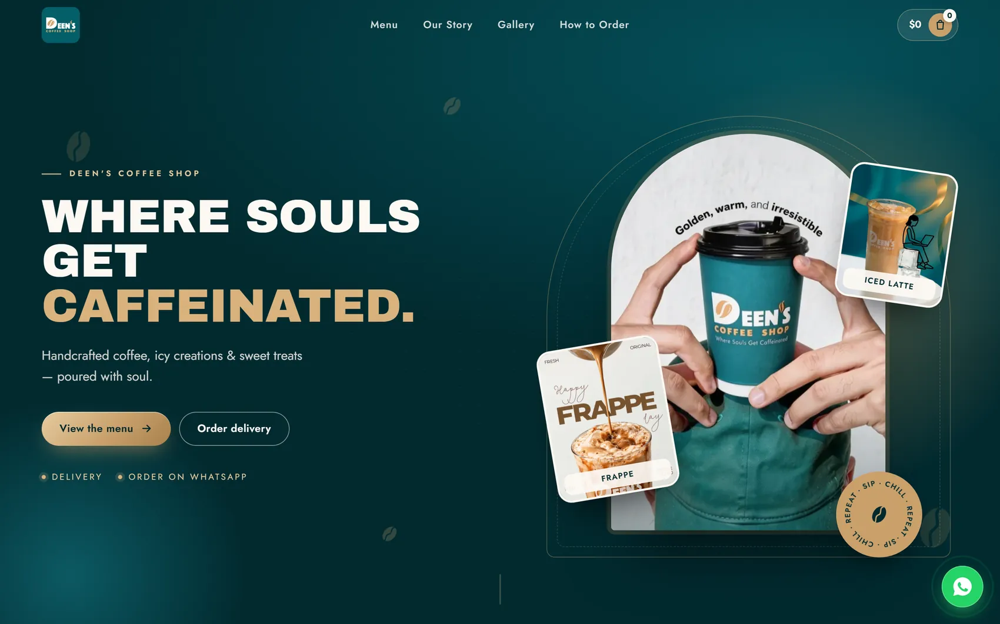
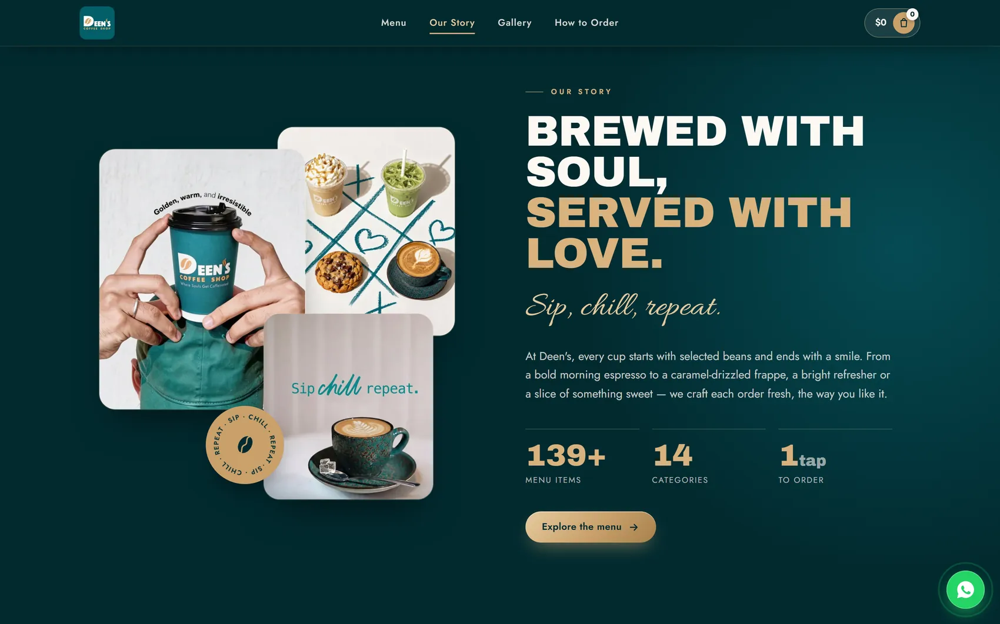

# Deen's Coffee

An ordering website for a coffee shop in Lebanon, with a GSAP-animated storefront and an admin panel the owner uses without a developer. Live on the shop's own domain.

**Live:** https://deenscoffeeshop.com




## Features
- Online ordering with a **unique order number per day** (resets each morning).
- **Admin panel**: edit menu items, prices, categories, and upload photos.
- Serverless API on Netlify; all data in **Netlify Blobs** (content, orders, uploads).
- Animated hero and story sections built with GSAP.

## Stack
Vite · Tailwind CSS 4 · GSAP · Node.js (Netlify Functions) · Netlify Blobs

## Run it
```bash
npm install
cp .env.example .env.local   # set ADMIN_PASSWORD
npx vite --host --port 5173  # local API + file store in .data/
```
Admin login is disabled until `ADMIN_PASSWORD` is set. The code ships with no default password.

## Deploy
`npx vite build`, then deploy `dist` with the functions in `netlify/functions` to Netlify.
